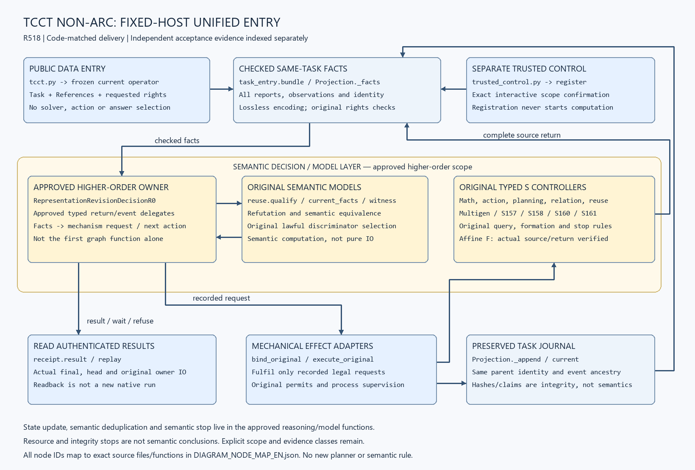

# TCCT Reasoning Research Preview
# TCCT 推理研究预览

This folder introduces the reasoning and learning research branch of TCCT and its unified-entry engineering work. It is a compact guide to the architecture and evidence, alongside the [main project README](../README.md) and the historical [S-series experimental suite](../core_source_code/TCCT_Model_Full_Experimental_Suite/).

本文件夹介绍 TCCT 的推理与学习研究分支及其统一入口工程，集中提供架构和证据导览，与[项目主 README](../README.md)及历史 [S 系列实验集](../core_source_code/TCCT_Model_Full_Experimental_Suite/)配合阅读。

## Research focus / 研究重点

The branch investigates how graph rewriting, semantic deduplication, freezing, induction, concept formation, epistemic control, and planning can work together in controlled symbolic and relational tasks. The current presentation is a **research prototype integrating multiple reasoning and learning mechanisms**. A unified task entry organizes selected workflows without treating the entry layer itself as the reasoning model.

该分支研究图重写、语义去重、冻结、归纳、概念形成、认知不确定性控制和规划如何在受控的符号与关系任务中协同工作。目前将其呈现为**集成多种推理与学习机制的研究原型**。统一任务入口用于组织部分工作流，入口层本身不等同于推理模型。

## Read in this order / 阅读顺序

1. **Architecture / 架构：** the original [R518 PNG](ARCHITECTURE_R518.png) and [R518 SVG](ARCHITECTURE_R518.svg), shown below.
2. **Evidence and boundaries / 证据与边界：** [Validation and Limitations / 验证范围与限制](VALIDATION_AND_LIMITATIONS.md).
3. **Current repair package / 当前修复包：** [TCCT_NonARC_ScopedRepair_ReadSafety_20261020_R1_NOT_STABLE](https://drive.google.com/drive/folders/14yHozPvgvO3hZO-x6-VarZ8xcSD2q8Th). Read its `README_FIRST_EN.txt` or `README_FIRST_ZH.txt` before attempting any use.

**Package status:** fixed-Windows, non-ARC, limited-scope repair delivery. It is not a stable release, generic installer, or portable application; required external software and project files are not all included. The delivery was not installed as the default entry.

**包状态：** 固定 Windows 环境、非 ARC、有限范围修复交付。它不是稳定版、通用安装包或可移植应用；所需外部软件和项目文件并未全部包含，也未被安装为默认入口。

## Original R518 architecture / 原始 R518 架构

The PNG and SVG are unchanged copies of the original supplied R518 diagram. They describe the historical fixed-host unified entry, not the exact implementation of the later R1 repair. The diagram's reference to `DIAGRAM_NODE_MAP_EN.json` belongs to the original R518 delivery; that mapping file is not included in this documentation folder.

PNG 与 SVG 均为所提供原始 R518 图的未修改副本。它们描述历史上的固定主机统一入口，不是后续 R1 修复的精确实现图。图中提及的 `DIAGRAM_NODE_MAP_EN.json` 属于原 R518 交付，本说明文件夹未包含该映射文件。

### How to read the diagram / 如何阅读架构图

- **Entry and checked facts:** task data and requested rights enter with identity and consistency checks.
- **Reasoning/model layer:** original model functions and typed S-series controllers carry the semantic decisions, including state updates, deduplication, and stopping.
- **Execution and journal:** adapters carry out recorded permitted requests, while the task journal preserves their history.
- **Authenticated readback:** result/replay reads preserved results. Reading a result is not a new native model run; a hash or receipt establishes integrity, not semantic correctness.

- **入口与已核验事实：** 任务数据和所请求权限经过身份与一致性检查。
- **推理／模型层：** 原模型函数及有类型约束的 S 系列控制器承担语义决策，包括状态更新、去重和停止。
- **执行与日志：** 适配层执行已记录且获准的请求，任务日志保存过程历史。
- **认证回读：** result/replay 读取已保存结果。回读不等于重新运行原生模型；哈希或回执说明完整性，不等于语义正确性。

## Scope / 范围

The evidence remains tied to named inputs, profiles, environments, and source versions. This preview does not claim 25 independent reasoning kernels, AGI, unrestricted theorem proving, demonstrated Turing completeness, or correctness on all inputs. Historical S-series experiments remain separate evidence for their own stated scopes; a unified entry does not automatically revalidate all of them.

证据仍与具体输入、配置、环境及源码版本绑定。本预览不宣称存在 25 个独立推理内核，也不宣称 AGI、无限制定理证明、已证明的图灵完备性或所有输入上的正确性。历史 S 系列实验仍分别支持其各自声明的范围，统一入口并不自动重新验证全部历史实验。
